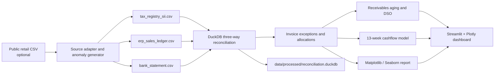

# SMB Cashflow Control

## Business Impact & Problem Solved

Small and mid-sized businesses often reconcile tax invoices, their internal sales ledger, and bank deposits through disconnected spreadsheets. This creates delayed visibility into missing postings, amount differences, partial collections, unidentified transfers, and near-term liquidity risk.

SMB Cashflow Control brings these three records together in an explainable workflow. It highlights invoice-level exceptions, allocates referenced and conservatively fuzzy-matched bank receipts, summarizes receivables aging, and projects weekly cash balances over a rolling 13-week horizon. The dashboard is designed to help finance teams prioritize follow-up and discuss liquidity scenarios; it is a decision-support demo, not tax, accounting, or investment advice.

The sample generator creates realistic, reproducible data without external credentials. When explicitly configured with a Kaggle dataset and Kaggle credentials, it can adapt invoice-level data from an Online Retail-style CSV instead. No real people or company names are included in the generated demo data.

## Architecture



## Features

- **Reconciliation monitor:** joins tax invoices, ERP postings, and bank credits; classifies reconciled, partially paid, unpaid, missing ERP, and amount/date exception cases. Bank deposits containing remittance references can be grouped, while unreferenced credits are only assigned when a unique amount-and-date candidate exists.
- **Cash forecast:** an interactive 13-week waterfall projection, with delinquency assumptions that reduce expected receipts and shift their expected collection timing. Projected operating outflows use the recent bank debit run rate.
- **Collection analytics:** receivables aging, a 90-day DSO indicator, a static payment-delay distribution and monthly DSO proxy, plus downloadable PNG and Excel exception reports.
- **Reproducible sample:** seeded source data includes approximately 5% ERP anomalies across date shifts, amount differences, and omitted postings, along with partial/grouped deposits, unidentified transfers, and operating debits.

## Quick start

### Docker Compose (recommended)

```bash
docker compose up --build
```

Open [http://localhost:8501](http://localhost:8501). The container creates its sample CSVs at startup if they are missing and persists them under `data/`.

### Local Python

Python 3.11 or newer is required.

```bash
python -m venv .venv
# Windows PowerShell:
.venv\Scripts\Activate.ps1
# macOS/Linux:
# source .venv/bin/activate
python -m pip install -r requirements.txt
python -m src.data_loader
streamlit run app/main.py
```

The data loader and compatibility entry point can also be run as `python -m src.data_generator`.

### Optional Kaggle input

The default path is fully offline and requires no API key. To use a public CSV dataset supported by the adapter, configure the Kaggle dataset slug and credentials before running the loader:

```bash
# Example for a compatible Online Retail-style dataset
KAGGLE_DATASET=owner/dataset KAGGLE_USERNAME=your-user KAGGLE_KEY=your-key python -m src.data_loader
```

For Online Retail-style sources, the default `KAGGLE_AMOUNT_TO_CLP=1200` converts source currency values to approximate CLP; set this factor to match the chosen dataset or use `1` when it is already denominated in CLP. Docker Compose passes these optional environment variables through. If Kaggle is not configured or its source cannot be accessed, the loader logs the reason and falls back to seeded synthetic data. Generated CSVs are in `data/raw/`; the app writes its DuckDB reconciliation table to `data/processed/reconciliation.duckdb`.

## Testing and quality

```bash
pytest -q
ruff check src app tests
flake8 --max-line-length=100 --extend-ignore=E203,W503 src app tests
```

The GitHub Actions workflow runs Ruff, Flake8, and Pytest on pushes and pull requests with Python 3.11.

## Data contracts and assumptions

| File | Purpose | Important fields |
|---|---|---|
| `tax_registry_sii.csv` | Issued invoice register | `invoice_id`, `invoice_date`, `due_date`, `total_amount` |
| `erp_sales_ledger.csv` | Internal sales postings | `invoice_id`, `entry_date`, `total_amount` |
| `bank_statement.csv` | Incoming credits and operating debits | `value_date`, `credit`, `debit`, `remittance_details` |

Amounts in the deterministic sample are in CLP. Automatic reference matching uses invoice identifiers embedded in bank remittance details. Unreferenced deposits are matched only if there is exactly one eligible invoice within a configurable amount tolerance and due-date window; ambiguous transfers remain unallocated. The cash forecast is a transparent scenario model, not a statistical prediction: delinquency represents receipts excluded from the projection horizon, and operating costs are estimated from recent observed debit activity. Production use should connect to authorized source systems, validate jurisdiction-specific tax rules, and independently review all fuzzy matches.
