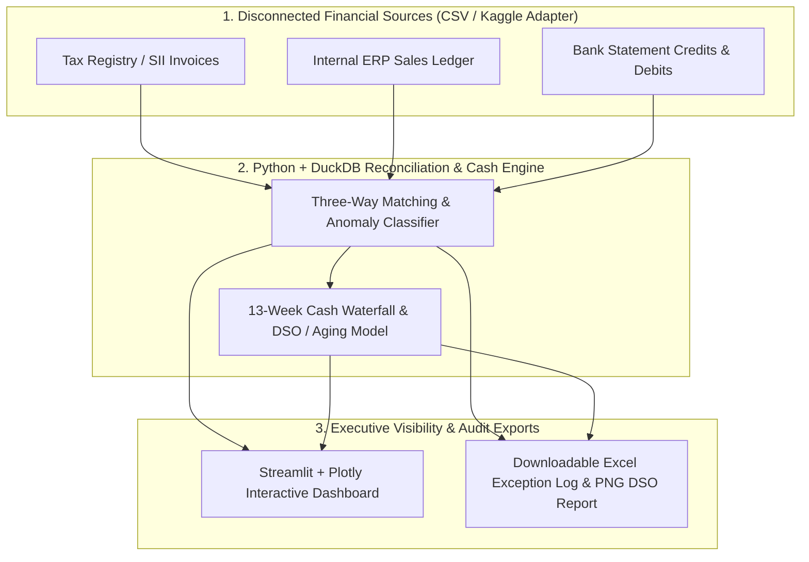

# SMB Cashflow Control & Three-Way Reconciliation Engine

[](https://github.com/longaresf/pyme-cashflow-reconciliation-demo/actions/workflows/ci.yml)


## Business Impact & Problem Solved

Small and mid-sized businesses (SMBs) frequently reconcile **tax invoices (SII/Tax Registry), internal ERP sales ledgers, and bank statements** through disconnected spreadsheets. This manual workflow causes delayed visibility into missing postings, amount discrepancies, partial collections, unidentified bank transfers, and near-term liquidity blind spots.

**SMB Cashflow Control** unifies these three financial records into an explainable, auditable workflow. It isolates invoice-level exceptions, allocates referenced and conservatively fuzzy-matched bank receipts, summarizes receivables aging, and projects weekly cash balances over a **rolling 13-week horizon**.

> **Scope Note:** Designed as an operational decision-support architecture for finance teams to prioritize collections and evaluate liquidity scenarios. It does not constitute tax, accounting, or investment advice. All sample data is deterministically generated with zero real personal or corporate records.

---

## System Architecture


## Features

- **Three-Way Reconciliation Monitor:** Joins tax invoices, ERP postings, and bank credits; classifies records into Reconciled, Partially Paid, Unpaid, Missing in ERP, and Amount/Date Exceptions. Supports grouped remittance references while restricting unreferenced matching strictly to unique amount-and-date candidates.

- **Interactive 13-Week Cash Forecast:** Rolling weekly waterfall projection with adjustable delinquency assumptions that reduce expected receipts and shift collection timing, paired with operating outflows modeled from recent bank debit run rates.

- **Collection & DSO Analytics:** Receivables aging buckets, 90-day DSO indicator, payment-delay distribution charts (Matplotlib/Seaborn), and one-click downloadable Excel exception reports.

- ** Offline & Kaggle Modes:** Seeded generator injects ~5% realistic ERP anomalies (date shifts, amount variances, omitted postings) alongside partial deposits and unidentified transfers—working 100% offline out of the box.

## Quick start

### Option 1: Docker Compose (Recommended)

```bash
docker compose up --build
```

Open [http://localhost:8501](http://localhost:8501). The container creates its sample CSVs at startup if they are missing and persists them under `data/`.

### Option 2: Local Python (3.11+)

```bash
python -m venv .venv
# Windows PowerShell:
.venv\Scripts\Activate.ps1
# macOS/Linux:
# source .venv/bin/activate
python -m pip install -r requirements.txt
python -m src.data_loader
streamlit run app/main.py
```

(Note: python -m src.data_generator is also supported as a compatibility entry point).

### Optional: External Kaggle Dataset Adapter

The default pipeline runs completely offline without API keys. To adapt an Online Retail-style CSV from Kaggle instead:

```bash
# Example for a compatible Online Retail-style dataset
KAGGLE_DATASET=owner/dataset KAGGLE_USERNAME=your-user KAGGLE_KEY=your-key python -m src.data_loader
```

Use KAGGLE_AMOUNT_TO_CLP=1200 (default) to scale source currency units to approximate CLP, or set to 1 if already denominated in CLP. If Kaggle is unconfigured or unreachable, the loader logs the fallback reason and generates deterministic synthetic data.

Data Contracts & Modeling Assumptions

Source File	                    Business Purpose	                                Key Schema Fields
data/raw/tax_registry_sii.csv	Official issued tax invoice register	            invoice_id, invoice_date, due_date, total_amount
data/raw/erp_sales_ledger.csv	Internal accounting / ERP sales postings	        invoice_id, entry_date, total_amount
data/raw/bank_statement.csv	    Bank account incoming credits & operating debits	value_date, credit, debit, remittance_details

## Testing and quality

```bash
pytest -q
ruff check src app tests
flake8 --max-line-length=100 --extend-ignore=E203,W503 src app tests
```

The GitHub Actions workflow runs Ruff, Flake8, and Pytest on pushes and pull requests with Python 3.11.

✒️ Author
Francisco Longares — Data Scientist & AI Solutions Developer — longaresf
